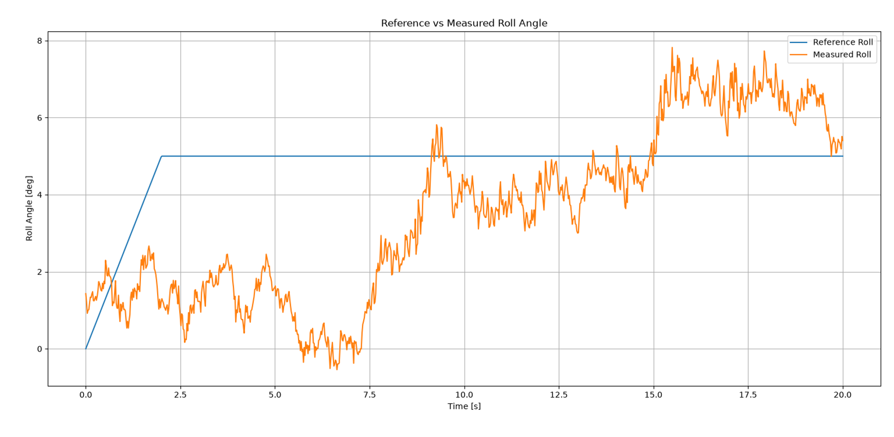

# rpi-gimbal-drone-control

Standalone attitude control and system identification for a quadrotor on a 3-DOF gimbal rig, running entirely on a Raspberry Pi 4. **No PX4, no MAVLink:** the scripts read an MPU6050 IMU, estimate attitude, run the controllers, mix to four motors and drive the ESCs directly with `pigpio`.

Developed for a bachelor's thesis on system identification and PID controller design for a "gimbal drone". The mixer geometry is PX4 v1.9.2's `quad_x`.

---

## Safety

- There is **no failsafe and no fallback stabilization** behind these scripts. The angle and rate aborts in each script are the only automatic protection.
- Several scripts run **open loop** (constant torque, chirp excitation). Nothing opposes them except the aborts.
- Run on the gimbal rig with mechanical stops, or with props off. Keep a hand on Ctrl+C / the power switch.
- Start with small amplitudes and step up across runs.
- Every script arms the ESCs first (900 us for 5 s). Motors are cut on exit and on `SIGTERM` / `SIGHUP` (SSH drop).

---

## Hardware

| Part | Detail |
|---|---|
| Computer | Raspberry Pi 4 |
| IMU | MPU6050 on I2C, address `0x68` |
| Motors / ESCs | 4 ESCs on GPIO 18, 19, 12, 13 (M1-M4), 1000-2000 us at 50 Hz via `pigpio` |
| Frame | Quad-X on a 3-DOF gimbal |

Motor layout: M1 front-right (CCW), M2 rear-left (CCW), M3 front-left (CW), M4 rear-right (CW).

---

## How it works

```
reference --> outer P (angle error -> rate reference) --> inner PID (rate error -> torque)
                 ^                                              ^
     angle (complementary filter)              gyro rate (bias-corrected, low-passed)

[tau_x, tau_y, tau_z, thrust] --> mixer --> motor_i in [0,1] --> PWM (1000-2000 us) --> ESCs
```

- **Attitude estimate:** complementary filter (alpha = 0.98) on accelerometer and gyro. Yaw is gyro-integrated only, so it drifts.
- **Inner PID:** parallel form with filtered derivative (`P + I/s + D*N/(1+N/s)`, N = 25) and conditional-integration anti-windup.
- **Rate filter:** causal 2nd-order Butterworth low-pass on the measured rate (roll 8 Hz, pitch 15 Hz, yaw 5 Hz in the three-axis script).
- **Mixer:** plain combine-and-clamp with the quad-X allocation matrix. Usable roll+pitch torque is `min(thrust, 1 - thrust) / 0.707`, so thrust sets how much torque authority you have.
- **Loop rate:** 50 Hz, matching `pigpio`'s servo pulse refresh. Running the computation faster does not reach the motors.

Identified roll model used for tuning (from the system-ID runs):
`phi_ddot = -a1*phi_dot - a0*phi + b*u`, with `b ~ 24.8`, `a0 ~ 25.9`, `a1 ~ 3.05` (DC gain about 54.9 deg per unit torque).

---

## Repository layout

```
hardware_tests/   ESC / motor PWM check
sysid/            excitation scripts for system identification
control/          open-loop test and closed-loop controllers
analysis/         plotting
```

### `hardware_tests/`

| Script | Purpose |
|---|---|
| `pwm_test4.py` | Sends 900 us, then 1000 us for 10 s, to all four ESCs, then stops. Confirms wiring and arming. **Props off.** |

### `sysid/`

| Script | Purpose |
|---|---|
| `standalone_chirp_sysid.py` | Roll-axis chirp on `tau_x` (0.3-2 Hz, 30 s), other axes held at zero. |
| `mimo_chirp_sysid.py` | Simultaneous chirps on all three axes in non-overlapping bands (roll 0.3-0.8, pitch 1.0-1.5, yaw 1.8-2.3 Hz, 40 s), so cross-axis coupling can be separated afterwards. Amplitude 0.05, thrust 0.2. |

### `control/`

| Script | Purpose |
|---|---|
| `open_loop_tau_x_test.py` | Constant `tau_x = 0.1` at thrust 0.2 for 15 s. Compares the steady roll angle with the model's prediction (about 5.5 deg). |
| `inner_loop_rate_control.py` | Inner rate PID only, tracking a constant roll-rate reference (5 deg/s). Tests the inner loop in isolation. |
| `single_loop_pid_roll.py` | One PID directly on roll angle error, no cascade. Baseline for a cascade comparison. Gains are conservative starting points, not tuned. |
| `roll_cascade_control.py` | Roll-only cascade (outer P + inner PID). Prints a saturation and torque-budget summary at the end. |
| `three_axis_cascade_control.py` | Roll, pitch and yaw cascades in one loop sharing one mixer. Pitch reference defaults to the rig's resting pitch (-4.5 deg). |

### `analysis/`

| Script | Purpose |
|---|---|
| `Plot_standalone_chirp_results_pitch.py` | Plots a pitch chirp log: input `tau_y`, pitch angle, pitch rate, and roll/pitch/yaw together. |

---

## Requirements

- Raspberry Pi 4 with I2C enabled (`sudo raspi-config`)
- Python 3
- `pigpio` with the daemon running
- `mpu6050-raspberrypi` (provides `from mpu6050 import mpu6050`)
- `numpy`, `pandas`, `matplotlib` (analysis only)

```bash
sudo apt install pigpio python3-pigpio
sudo pigpiod
pip install mpu6050-raspberrypi
```

---

## Calibration

The IMU constants at the top of each script are specific to my sensor and mounting:

- `GYRO_BIAS` (deg/s)
- `ROLL_OFFSET_DEG`, `PITCH_OFFSET_DEG`

Re-measure them for your setup (level the rig, average the gyro and accelerometer at rest). Mind the signs: the roll formula is `atan2(ay, -az)` and the pitch formula is `atan2(-ax, ...)`, so the pitch offset has the opposite sign to the measured x tilt.

---

## Usage

Run scripts from the repo root. Each writes a CSV to the current directory.

```bash
sudo pigpiod
python3 hardware_tests/pwm_test4.py
python3 control/roll_cascade_control.py
```

Suggested order:

1. `pwm_test4.py`: check wiring and arming (props off).
2. `open_loop_tau_x_test.py`: compare measured and predicted steady roll.
3. `standalone_chirp_sysid.py`, then `mimo_chirp_sysid.py`: collect identification data.
4. `inner_loop_rate_control.py`: check the inner loop alone.
5. `single_loop_pid_roll.py` and `roll_cascade_control.py`: single-loop vs cascade.
6. `three_axis_cascade_control.py`: full attitude control.

Edit the `CONFIG` block at the top of each script (thrust, references, gains, safety limits).

---

## Logged data

Every script writes a CSV with time, the commanded input, roll/pitch/yaw angles (rad), body rates (rad/s) and the four PWM values. Control scripts also log references, torque commands and mixer/PID saturation flags.

| Script | Output file |
|---|---|
| `standalone_chirp_sysid.py` | `standalone_chirp_roll_log.csv` |
| `mimo_chirp_sysid.py` | `mimo_chirp_sysid_log.csv` |
| `open_loop_tau_x_test.py` | `open_loop_tau_x_log.csv` |
| `inner_loop_rate_control.py` | `inner_loop_rate_control_log.csv` |
| `single_loop_pid_roll.py` | `single_loop_pid_roll_log.csv` |
| `roll_cascade_control.py` | `roll_cascade_log.csv` |
| `three_axis_cascade_control.py` | `three_axis_cascade_log.csv` |

---

## Example results

**Roll cascade, 5 deg reference** (`roll_cascade_control.py`, 2 s ramp then hold, 20 s run)



The measured roll follows the reference only loosely: it wanders roughly 0-8 deg around the 5 deg target and does not settle.

---

## Known limitations

- Roll tracking on the rig is loose (see the plot above). Gains were tuned on identified models and have not been refined on hardware.
- 50 Hz actuation caps the achievable closed-loop bandwidth. Faster actuation would need `set_PWM_frequency()` with re-verified gains.
- The offline fit used zero-phase `filtfilt`. The real-time filter is causal and adds phase lag, so expect to retune slightly (generally lower gains).
- Derivative gains are far below the Simulink-tuned values because the real gyro noise otherwise saturates the mixer.
- The mixer clamps per motor and does not replicate PX4's airmode desaturation. Clamping is counted in the run summaries.
- `standalone_chirp_sysid.py` uses earlier IMU calibration values and thrust 0.5, not the latest ones used elsewhere.
- Complementary filter, not an EKF. Yaw drifts.
